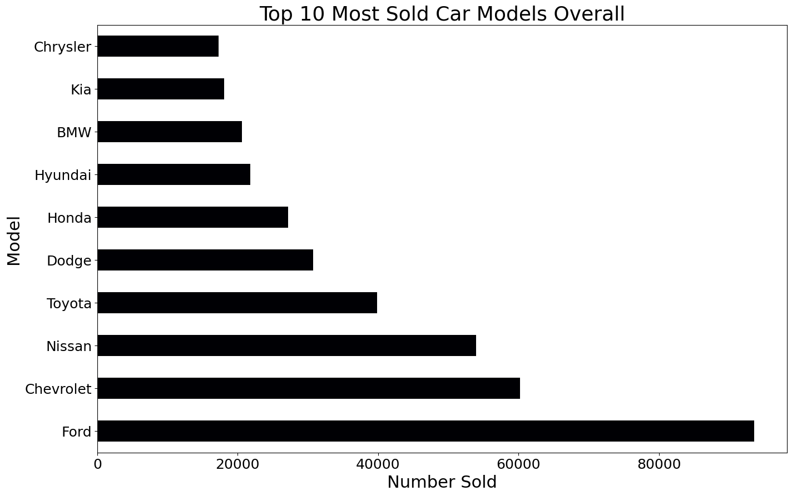
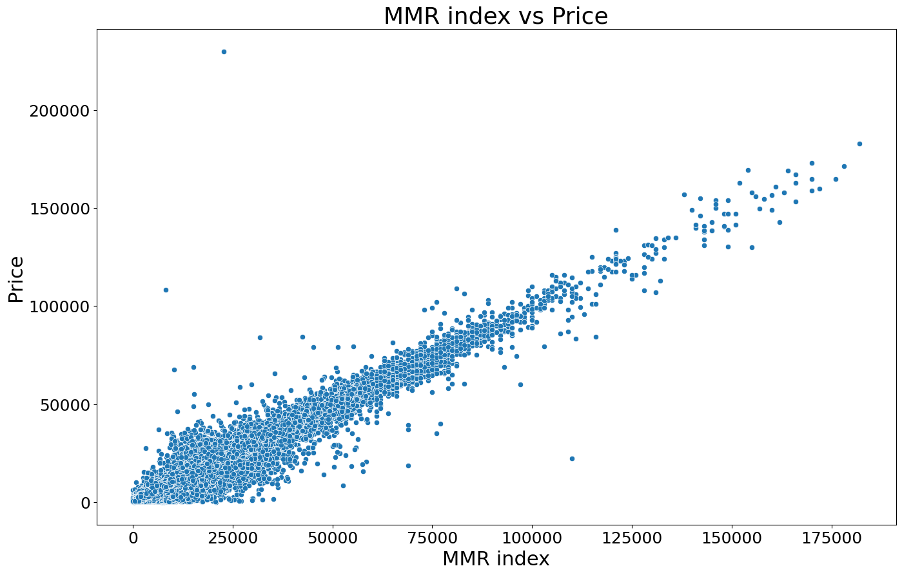
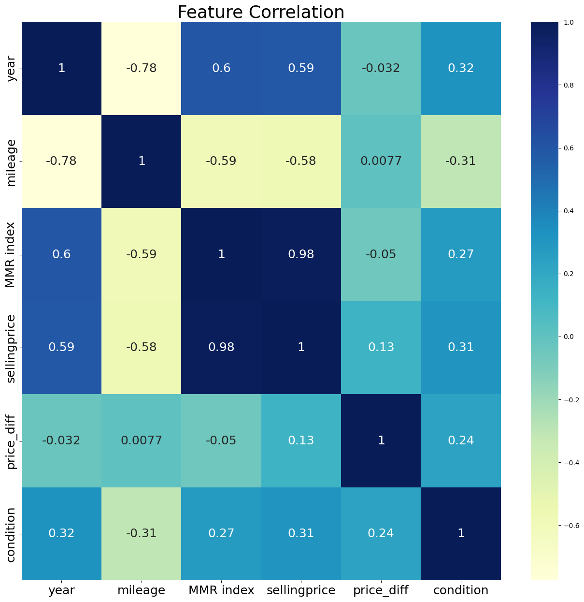
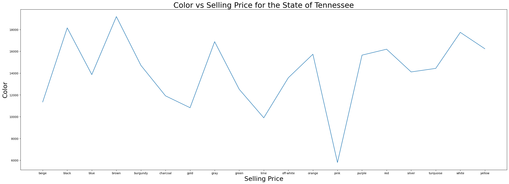

# Car Dealership EDA

Exploratory data analysis of 558,837 used-car sales, to help a California dealership decide what to stock, how to price, and where to expand.

## Results

This is descriptive analysis. The notebook has no predictive model, so there is no accuracy score or baseline to compare against.

- 558,837 sales were loaded. 545,544 rows remain after dropping rows with a missing make, model or body.
- Ford is the top-selling make, followed by Chevrolet and Nissan.
- Four states (FL, CA, PA, TX) account for more than half of the sales.
- The three highest-volume sellers sold between 18,261 and 19,693 cars each. Their most common makes are Nissan, Ford and Chevrolet, in that order.
- In California, the Ford Focus SE is the top make and model, with 758 sales.
- In Tennessee, brown had the highest average selling price ($19,184). Yellow ($16,234) is not second: black ($18,149) and white ($17,738) are both higher.
- Mileage and selling price are negatively correlated.









## Problem

A California dealership was losing sales as new competitors entered the market, amid an influx of foreign cars into the US. The business asked for a data-driven view of what to stock, how to price, and where to expand. The notebook answers eight business questions covering makes and models, states, mileage, condition, price against the MMR index, colour, and the top sellers.

## Data

- **Source:** not named in the repository. The notebook reads a file called `car_prices.csv`, which is not included.
- **Size:** 558,837 rows and 16 columns, with model years from 1982 to 2015.
- **Columns:** year, make, model, trim, body, transmission, vin, state, condition, odometer, color, interior, seller, mmr, sellingprice and saledate.

## Approach

- **Cleaning:** the VIN is used as the index. `model` and `trim` are merged into one column. `transmission` and `saledate` are dropped.
- **New feature:** `price_diff = sellingprice - MMR index`, which compares each sale with the market index.
- **Missing values:** rows missing make, model or body are dropped, because imputing them would give wrong values. Missing selling price, MMR, condition and mileage are filled with column means. Colour and interior are back-filled.
- **Analysis:** grouped counts and means with pandas, plotted with Matplotlib and Seaborn, plus correlation heatmaps for the numeric columns.
- **Questions:** each of the eight business questions has a short written interpretation below it. Not every question has a chart: the MMR-vs-price difference question has none.

## Repository contents

| File | Description |
|------|-------------|
| [`Dealership EDA.ipynb`](Dealership%20EDA.ipynb) | The analysis notebook: problem statement, data preparation, business questions and conclusions. Charts are saved as cell outputs. |
| `Car_Dealership_EDA_Farid_Rahimli.htm` | HTML export of the same notebook with outputs, for reading without Jupyter. GitHub shows `.htm` files as source, so download it and open it in a browser. |
| `images/` | Four charts taken from the notebook outputs, used in this README. |
| `.gitignore` | Keeps the large `car_prices.csv` and Jupyter checkpoint files out of the repository. |

## How to run

This is a notebook-only project. It has no scripts and no tests.

```bash
pip install pandas matplotlib seaborn jupyter
# put car_prices.csv in the same folder as the notebook, then:
jupyter notebook "Dealership EDA.ipynb"
```

Cell 3 also imports `mpl_toolkits.basemap` and `plotly.express`, but no later cell uses them. If Basemap is hard to install, delete those two import lines and the notebook runs without them.

## Limitations and next steps

- **Imputation and outliers:** column means fill the missing selling price, MMR, condition and mileage values, which narrows their spread. The largest `price_diff` in the notebook is $207,200 (Ford-Lincoln Dealer Program), which looks like an outlier that was not checked. Next: check outliers and try median or model-based imputation.
- **Scope:** the analysis is descriptive, with no statistical tests. Sale dates were dropped, so there is no time trend. The mileage question measures correlation with price, not sales volume.
- **Labels and claims:** the seller field includes finance and rental companies (Ford Motor Credit, The Hertz Corporation), so "dealership" is a loose label. The notebook says US buyers prefer American-made cars. The two top makes by volume are American (Ford, then Chevrolet), which is consistent with that, but the analysis does not measure brand origin or buyer preference, and Nissan, third, is not American. Treat the claim as untested. The top-makes chart is titled "Models" but counts makes.
- **Next steps:** fix the chart titles, remove the unused imports, add a `requirements.txt`, and name the dataset source.

Coursework for M504B (final assessment).
